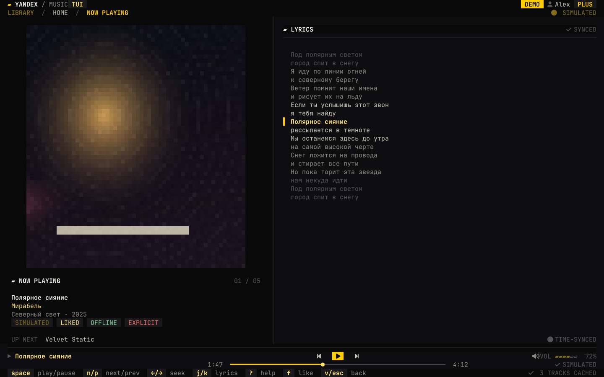
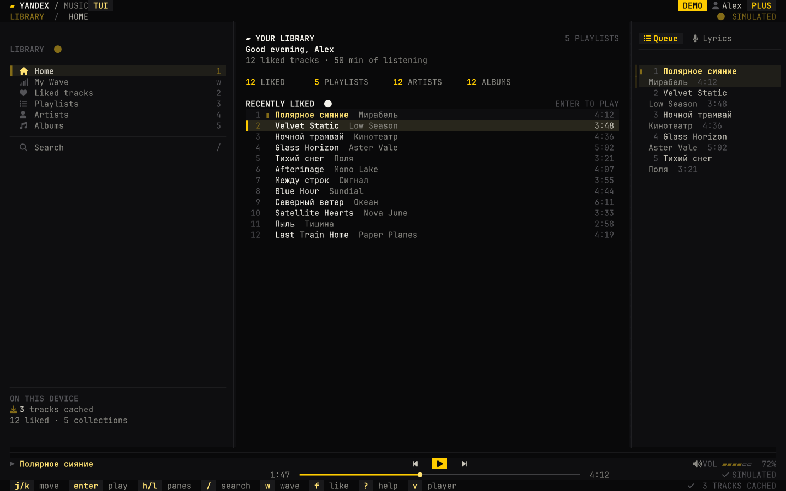
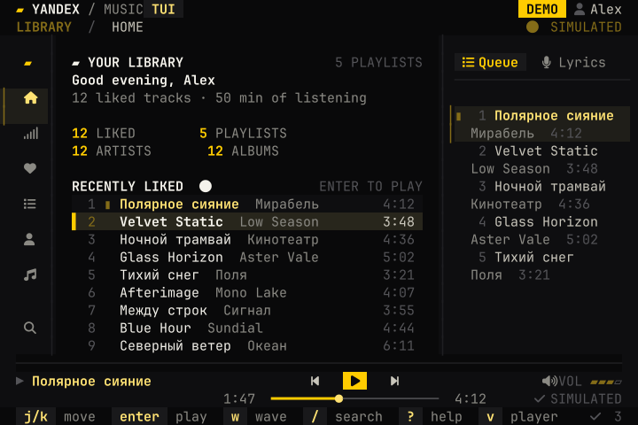
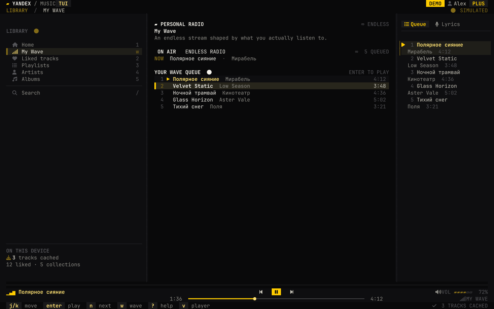

# yandex-music-tui

A keyboard-first, **unofficial** Yandex Music client for the terminal. Built in
Rust with [ratatui], [crossterm], [rodio], and [yamuse], with a dark
black-and-yellow interface designed for long listening sessions.



The layout adapts from a roomy three-pane workspace down to an 80×24 terminal:
a labelled sidebar folds into an icon rail and the queue/lyrics inspector stays
visible as long as possible.

| Library, wide | Library, 80×24 |
| --- | --- |
|  |  |



> The screenshots are real ratatui frames exported with
> [`examples/screenshot.rs`](examples/screenshot.rs), not mockups. Demo mode uses
> entirely fictional artists, albums, lyrics, and generated cover art.

## Features

- **Sign in your way** — OAuth device flow, a pasted access token, `--token`, or
  `YANDEX_MUSIC_TOKEN` / `YM_TOKEN`.
- **Your library** — liked tracks, playlists, artists, and albums, with
  asynchronous detail views that never block the interface.
- **My Wave** — a genuine personal radio stream, not a shuffled static queue.
  Press `w` to tune in; new rotor batches arrive automatically at the end of the
  queue, and listening feedback keeps the station personal.
- **Real playback** — play/pause, next/previous, seek, volume, and mute through a
  dedicated audio thread. ALSA is used through rodio.
- **Synced lyrics** — time-coded LRC with automatic follow, plus plain-text
  fallback. Scroll lyrics manually in Now Playing by pressing `j` / `k`.
- **A dedicated Now Playing screen** — large half-block cover art, track
  metadata, queue context, and a full lyric sheet.
- **Offline cache** — playback is buffered locally; press `d` to download a
  selected track ahead of time. Partial files are never treated as complete.
- **Resilient by design** — API, My Wave, and artwork failures become visible
  status messages, never panics. Failed requests retry with exponential backoff
  and can be retried immediately with `r`.
- **Responsive chrome** — 30/50/20 wide panes, a compact icon rail below 116
  columns, an inspector that disappears only on very narrow terminals, and
  keyboard hints that drop whole items instead of clipping them.
- **No mouse required** — every action has a key binding.

## Install

### Arch Linux (AUR)

The repository contains a `PKGBUILD` for `yandex-music-tui-git`. It builds the
current git revision and installs the binary, license, README, and example
config.

`makepkg` uses a `src/` directory of its own, so build the recipe from a separate
packaging directory instead of the Rust checkout:

```sh
sudo pacman -S --needed base-devel git rust pkg-config alsa-lib openssl
git clone https://github.com/shake-11/yandex-music-tui.git /tmp/yandex-music-tui-src
mkdir -p /tmp/yandex-music-tui-git
install -Dm644 /tmp/yandex-music-tui-src/PKGBUILD /tmp/yandex-music-tui-git/PKGBUILD
cd /tmp/yandex-music-tui-git
makepkg -si
```

When the package is published to the AUR, it can also be installed with an AUR
helper such as `paru -S yandex-music-tui-git`.

### From source

Dependencies on Arch:

```sh
sudo pacman -S --needed base-devel rust pkg-config alsa-lib openssl
```

Build and run:

```sh
cargo build --release
./target/release/yandex-music-tui --demo
```

Install the binary somewhere on `PATH`:

```sh
install -Dm755 target/release/yandex-music-tui ~/.local/bin/yandex-music-tui
```

The minimum supported Rust version is **1.85**.

## First run

```sh
yandex-music-tui --demo     # explore with a fictional, offline library
yandex-music-tui --login    # start the OAuth device flow immediately
yandex-music-tui            # use a saved session, if one exists
```

On the sign-in screen, press `d` to start the device flow. Open the displayed
verification URL in any browser and enter the code. Alternatively, press `t`
and paste an existing Yandex Music OAuth token.

A successful device sign-in is saved in:

```text
~/.config/yandex-tui/config.toml
```

The file is written with owner-only permissions (`0600`). Tokens supplied with
`--token` or through the environment are used for that session only and are not
written to disk. To use a different file, pass `--config <path>`.

For a Nerd Font–style icon rail and the intended look, install a Nerd Font such
as JetBrainsMono Nerd Font and select it in the terminal. The interface remains
usable without one, but private-use icon glyphs may render as boxes.

## Keys

| Key | Action |
| --- | --- |
| `j` / `k`, `↓` / `↑` | Move down / up |
| `g` / `G` | Jump to first / last item |
| `h` / `l` | Focus previous / next pane |
| `Tab` | Cycle focus between panes |
| `Enter` | Play the selected track or open the selected collection |
| `1`–`5` | Jump to Home, Liked, Playlists, Artists, or Albums |
| `w` | Start My Wave or return to the live wave page |
| `/` | Search the catalogue |
| `Esc` | Go back or dismiss the current overlay |
| `f` | Like / unlike the selected track |
| `d` | Download the selected track for offline listening |
| `r` | Retry a failed request immediately |
| `Space` | Play / pause |
| `n` / `p` | Next / previous track |
| `←` / `→` | Seek in Now Playing |
| `Ctrl` + `←` / `Ctrl` + `→` | Seek from anywhere |
| `+` / `-` | Raise / lower volume |
| `m` | Mute / unmute |
| `v` | Open or close the dedicated Now Playing screen |
| `i` | Switch the inspector between Queue and Lyrics |
| `[` / `]` | Show Queue / Lyrics directly |
| `?` | Keyboard map |
| `q`, `Ctrl` + `c` | Quit |

In search, `Tab` moves between the query and results. `Enter` opens or plays the
selected result. Search runs against the Yandex Music catalogue, not just the
local library.

In Now Playing, `j` / `k` nudge the lyric sheet and `g` resets it:

- [x] auto-follow when a time-coded line becomes active
- [x] manual offset while staying on the same track
- [x] plain-text fallback when no timestamps are available
- [x] empty state for instrumentals or unavailable lyrics

## My Wave

Press `w` from any screen to start or reveal **My Wave**. This talks to Yandex
Music's real rotor station (`user:onyourwave`) and plays its progression; it is
not a local shuffle of the saved library.

- The first batch replaces the current queue when the wave starts; later batches
  are appended. When playback reaches the end, or `n` is pressed on the last
  queued track, another batch is requested with the previous batch's final track
  id as the queue cursor.
- `radioStarted`, `trackStarted`, `trackFinished`, and `skip` are reported back to
  the station. Feedback is best-effort and never blocks playback.
- A dropped network request is shown on the wave page and in the footer. Retries
  use exponential backoff; press `Enter` or `r` to retry immediately. The existing
  queue remains usable while the next batch is tuned.
- Starting a track from another library section ends the current wave. Press `w`
  again to start a fresh one. The player source reads `MY WAVE` while the
  station is active.

## Configuration

Start from [`config.example.toml`](config.example.toml), or run once and edit the
file the app creates.

```toml
[playback]
volume = 0.72
quality = "high"          # "low", "normal", "high", or "best"
seek_step_seconds = 10

[ui]
animations = true
cover_art = true
compact_sidebar_below = 116

[cache]
enabled = true
directory = ""            # empty: ~/.cache/yandex-tui/audio
```

| Setting | Meaning |
| --- | --- |
| `auth.access_token` | Access token, usually filled in by sign-in |
| `auth.refresh_token` | Refresh token from the device flow |
| `playback.quality` | Closest available MP3 bitrate: 64/128/192/320 kbit/s |
| `playback.seek_step_seconds` | Seek step used by both seek shortcuts |
| `ui.animations` | Playback and loading pulses |
| `ui.cover_art` | Half-block album art; disable for plain placeholders |
| `ui.compact_sidebar_below` | Width at which the sidebar becomes an icon rail |
| `cache.enabled` | Keep the offline cache between runs and allow `d` |
| `cache.directory` | Optional audio directory override |

With `cache.enabled = false`, playback still uses a temporary session cache
(`~/.cache/yandex-tui/session-<pid>`) so streaming works, but that directory is
removed on exit and `d` reports that offline pinning is disabled.

### Cache and downloads

Tracks are streamed into the cache through a sibling `.part` file and atomically
renamed only after a complete transfer. The index never contains a partial file,
so an interrupted download cannot leave a broken track that looks playable.
Cover art and lyrics are requested lazily for the current track.

## Architecture

```text
src/
├── api/          yamuse client, auth bootstrap, downloads, demo library
├── app.rs        pure application state, key handling, actions, retry plans
├── runtime.rs    async orchestration, terminal loop, background tasks
├── player.rs     dedicated rodio thread and player events
├── ui/           shell, panes, overlays, Now Playing, themes, primitives
├── cache.rs      atomic on-disk audio index
├── config.rs     XDG paths, TOML schema, 0600 persistence
├── cover.rs      image decoding and procedural cover generation
├── lyrics.rs     LRC / plain lyrics parsing and active-line lookup
└── model.rs      API-independent domain types
```

The UI is a function of `App` and returns no I/O errors; interactions produce
`Action` values that `runtime.rs` executes. Rendering can therefore be exercised
in a `ratatui::backend::TestBackend` at any size, which is how the screenshot
generator and layout tests work.

### Reproducing the screenshots

```sh
cargo run --release --example screenshot -- \
  --screen now --width 160 --height 45 --out assets/screenshot.svg
rsvg-convert -o assets/screenshot.png assets/screenshot.svg
```

Other screens are available with
`--screen home|wave|liked|search|help|auth`, and `--dump` prints the textual
frame for quick inspection.

## Development

```sh
cargo fmt
cargo test
cargo clippy --all-targets -- -D warnings
cargo build --release
```

The library tests cover configuration, cache safety, lyrics timing, API
selection, My Wave batching and feedback, layout rendering at multiple
breakpoints, playback queue behavior, and demo data. There are also CLI parsing
tests.

## Known limitations

- This is an unofficial client built on Yandex Music's private API. Endpoints can
  change or disappear without notice; a region restriction may make a track
  unplayable even though it appears in the library.
- There is no shuffle, repeat, playlist editing, social feed, or music video
  support. My Wave is the only radio station; station mood/energy tuning is not
  exposed yet.
- Playback currently selects MP3 variants. Gapless playback is not implemented.
- Album art uses truecolor half-block rendering. It degrades to a generated
  placeholder rather than attempting Kitty/Sixel protocols.
- The interface targets Unix-like terminals and is packaged for Arch Linux.
- Offline downloads are for personal use and remain subject to Yandex Music's
  terms.

## Legal

`yandex-music-tui` is an independent hobby project. It is **not affiliated with,
endorsed by, or supported by Yandex**. “Yandex Music” and related marks belong to
their respective owners. The project does not distribute music, album art, or
lyrics and does not operate an authentication server. Use it with your own
account and at your own risk.

Released under the [MIT License](LICENSE).

[ratatui]: https://ratatui.rs
[crossterm]: https://github.com/crossterm-rs/crossterm
[rodio]: https://github.com/RustAudio/rodio
[yamuse]: https://github.com/flxxxxddd/yamuse
